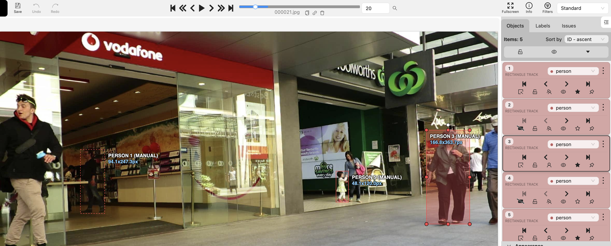
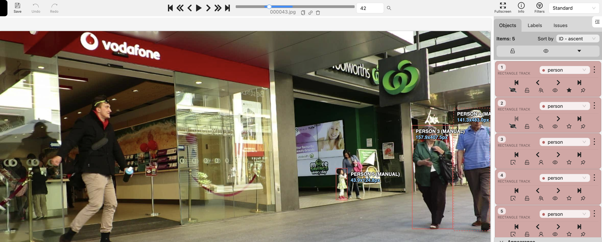
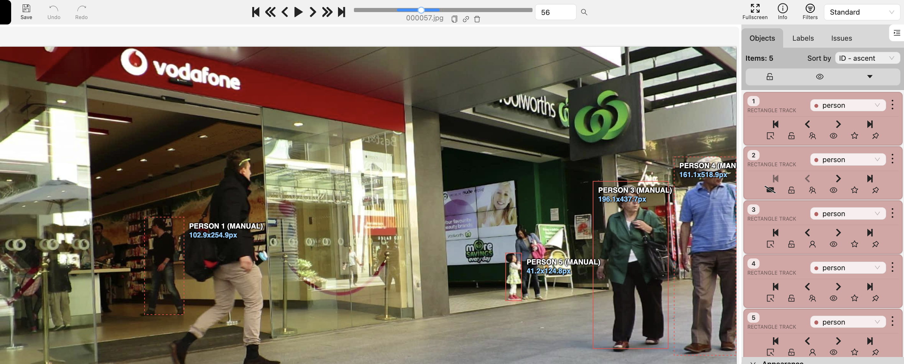

# Báo cáo cá nhân — Tạ Ngọc Huyền Trang — 2A202603251

Đoạn video: MOT17-09, 150 frame (frame 1–150), nguồn MOTChallenge, giấy phép CC BY-NC-SA 3.0.

Các số frame trong báo cáo được ghi theo CVAT (0–149).

## 0. Thông tin học viên

- Họ tên: Tạ Ngọc Huyền Trang
- MSSV: 2A202603251
- Mã đề (A/B/C): A
- Email: tnhtrang.works@gmail.com
- Link repository: https://github.com/trangtnh/K5-L2B-DAY05-TaNgocHuyenTrang-2A202603251-MOTTracking
- Giờ bắt đầu: 16:30 ngày 13/11/2026
- Giờ kết thúc: 18:00 ngày 13/11/2026
- Tổng thời gian: 90 phút

## 1. Xem trước đoạn video (CP0)

| Mã | Frame xuất hiện | Frame cuối thấy được | Rẽ / dừng / đổi tốc độ ở frame | Bị che ở frame | Ghi chú |
|---|---|---|---|---|---|
| P1 | 0 | 149 | -| 0–41, 45–149 | Người mặc áo len đen trong cửa hàng Vodafone, bị che một phần ngay từ đầu. |
| P2 | 60 | 149 | - | 60–101 | Người được khoanh P2 trong bảng nhận diện đề A; bắt đầu gán tại frame 60. |
| P3 | 0 | 149 | -| Không | Người phụ nữ mặc áo xanh, xuất hiện xuyên suốt video. |
| P4 | 40 | 149 | -| 40–65 | Người mặc áo xanh kẻ, bị che một phần cánh tay. |
| P5 | 0 | 146 | - | 110, 135–146 | Bé gái, có đoạn bị che hoàn toàn rồi xuất hiện trở lại. |

Các mốc trong bảng được tổng hợp từ ghi chú thực hành và đối chiếu với file export. Frame bắt đầu của P4 là mốc bắt đầu gán nhãn; trước đó mình đã thấy một phần cánh tay của người này.

## 2. Keyframe và thời gian (CP1, CP4)

Số keyframe lấy từ kết quả `src/check_submission.py`. Chỉ tính keyframe ở frame có `outside=0`.

P1–P5 lần lượt có ID XML là 0, 1, 2, 3, 4; ID trong MOT là 1, 5, 2, 4, 3.

| Mã | Số keyframe | Keyframe ở frame | Số frame có mặt | Keyframe / 100 frame | Thời gian (phút) | Chỗ khó |
|---|---:|---|---:|---:|---|---|
| P1 | 34 | 0, 3, 6, 8, 9, 10, 11, 12, 13, 14, 15, 16, 17, 18, 20, 27, 30, 32, 35, 37, 38, 40, 45, 52, 62, 72, 82, 92, 102, 112, 122, 132, 142, 149 | 147 | 23.1 | Không ghi riêng | Xác định vị trí khi bị che và duy trì ID khi xuất hiện lại. |
| P2 | 21 | 60, 70, 80, 90, 100, 102, 110, 120, 121, 125, 127, 129, 131, 132, 136, 138, 140, 141, 144, 146, 149 | 90 | 23.3 | Không ghi riêng | Xác định thời điểm xuất hiện và hết bị che. |
| P3 | 68 | 0, 1, 2, 5, 7, 8, 9, 10, 20, 26, 30, 32, 35, 37, 39, 40, 41, 45, 47, 49, 50, 55, 57, 59, 60, 61, 62, 63, 65, 67, 68, 69, 70, 73, 76, 77, 79, 80, 86, 87, 88, 89, 90, 93, 95, 96, 97, 99, 100, 106, 108, 109, 110, 115, 116, 118, 120, 121, 122, 125, 126, 127, 128, 129, 130, 140, 142, 149 | 150 | 45.3 | Không ghi riêng | Không ghi riêng. |
| P4 | 36 | 40, 41, 45, 47, 60, 66, 70, 73, 78, 79, 80, 81, 82, 83, 84, 85, 88, 90, 91, 98, 100, 108, 110, 111, 112, 118, 120, 121, 128, 129, 130, 131, 138, 140, 148, 149 | 110 | 32.7 | Không ghi riêng | Một phần cơ thể bị che khi xuất hiện. |
| P5 | 11 | 0, 10, 20, 30, 40, 50, 110, 135, 140, 142, 144 | 123 | 8.9 | Không ghi riêng | Theo dõi qua đoạn bị che hoàn toàn và xuất hiện lại. |
| **Tổng** | **170** | — | **620** | **27.4** | **90** | — |

Keyframe / 100 frame của cả bài = 170 ÷ 620 × 100 = **27.4**.

**Bạn đặt keyframe nhiều nhất ở người nào? Vì sao?**

Mình đặt nhiều keyframe nhất ở P3, với 68 keyframe trên 150 frame. Trong quá trình làm, mình chưa chú ý nhiều đến cách phân bố keyframe nên chưa ghi lại lý do cụ thể cho từng lần chỉnh box.

## 3. Đoạn bị che (CP2)

Người bị che: **P1** — Track ID 1 trên giao diện CVAT.

| Mốc | Frame |
|---|---:|
| Bắt đầu bị che một phần (bật `occluded`) | 0 |
| Mất hẳn (bật `outside`) | 42 |
| Hiện lại (tắt `outside`) | 45 |
| Thấy rõ trở lại (tắt `occluded`) | Chưa tắt trong file xuất |

- Thời gian khuất hẳn: 3 frame (42–44) = 0,10 giây.
- Quyết định: Giữ nguyên Track ID.
- Lý do: Thời gian bị che hoàn toàn chỉ có 3 frame, nhỏ hơn ngưỡng 60 frame. Mình tiếp tục sử dụng Track cũ khi P1 xuất hiện trở lại. Mình chưa ghi lại nhận xét cụ thể về ngoại hình, hướng đi và tốc độ tại thời điểm này.

Ngoài P1, P5 cũng có đoạn bị che hoàn toàn từ frame 111 đến 134 (24 frame, tương đương 0,80 giây). Mình giữ nguyên Track ID khi P5 xuất hiện lại tại frame 135.

Các mốc trên được lấy theo file export. Ghi chú ban đầu của mình về thời điểm P1 biến mất và xuất hiện lại lần lượt là frame 43 và 56; P5 xuất hiện lại ở frame 136.

**Ảnh chụp màn hình:**



Frame 20: P1 vẫn nhìn thấy một phần cơ thể, bật `occluded` và chưa bật `outside`.



Frame 42: P1 bị che hoàn toàn, bật `outside`.



Frame 56: P1 xuất hiện trở lại với Track ID 1, vẫn bật `occluded`.

Nguồn ảnh: MOT17, MOTChallenge (Milan et al., 2016).

## 4. Tự review ID (CP3)

Mình đã thực hiện hai lượt review: theo từng người và theo toàn cảnh. Sau khi kiểm tra, mình chưa ghi nhận lỗi cần sửa.

| Frame | Mã người | Loại lỗi | Mô tả một câu | Phát hiện ở lượt | Đã sửa? |
|---|---|---|---|---|---|
| 0–149 | P1–P5 | — | Đã kiểm hai lượt, chưa ghi nhận lỗi | Cả hai lượt | Không có lỗi được sửa |

Tổng hợp số lỗi theo loại:

| `id_switch` | `fragmentation` | `lost` | `merge` | `false_track` | `drift` | `flag` |
|---:|---:|---:|---:|---:|---:|---:|
| 0 | 0 | 0 | 0 | 0 | 0 | 0 |

**Lỗi nào chỉ lượt 2 (theo cảnh) mới thấy, lượt 1 (theo người) không thấy? Vì sao?**

Mình chưa ghi nhận trường hợp nào chỉ phát hiện ở lượt 2.

## 5. File xuất và kết quả tự kiểm (CP4)

| Kiểm tra | Kết quả |
|---|---|
| Tên file MOT 1.1 | `TaNgocHuyenTrang_mot.zip` |
| Tên file CVAT for video 1.1 | `TaNgocHuyenTrang_cvat_video.zip` |
| Số track ID khác nhau trong `gt/gt.txt` (phải là 5) | 5 |
| Frame `outside` không có dòng trong `gt.txt` (đúng / sai) | Đúng |
| Job đã completed trên CVAT máy cá nhân | Có; Job #24, state=`completed`, stage=`annotation` (kiểm tra trực tiếp ngày 13/11/2026) |

Kết quả từ `src/check_submission.py`:

```text
=== Tóm tắt ===
  Lỗi: 0   |   Cảnh báo: 0
  Đạt. Dán phần tóm tắt này vào báo cáo mục 5.
```

## 6. Ba câu kết

**1. Nếu được gán lại, bạn sẽ đặt keyframe khác ở đâu? Vì sao?**

Trong quá trình làm, mình chưa chú ý nhiều đến cách đặt keyframe. Mình chưa xác định được frame cụ thể muốn thay đổi nếu thực hiện lại.

**2. Có chỗ nào bạn không chắc "cùng ID hay ID mới"? Bạn đã quyết định và ghi chú thế nào?**

Mình không ghi lại trường hợp nào còn phân vân giữa việc giữ ID cũ và tạo ID mới. Với P1 và P5, mình giữ nguyên Track ID khi hai người xuất hiện trở lại sau đoạn bị che hoàn toàn.

**3. Một lỗi ID trong job của bạn (nếu không còn sót, chọn lỗi đã sửa) có thể làm xe tự lái dự đoán sai chuyển động của người đó như thế nào? Lỗi đó ảnh hưởng MOTA hay IDF1 nhiều hơn?**

Sau hai lượt review, mình chưa ghi nhận lỗi ID nào đã sửa để lấy làm ví dụ thực tế. Mình chưa bổ sung phần phân tích ảnh hưởng đến dự đoán chuyển động, MOTA và IDF1.

## 7. Tài liệu tham khảo và công cụ AI đã dùng

- Tài liệu lab Day 05: README.md, RULES.md, CHECKPOINTS.md, RUBRIC.md, SUBMISSION.md, các tài liệu trong docs/ và mẫu báo cáo cá nhân.
- Dữ liệu: MOT17, MOTChallenge (Milan et al., 2016).
- Codex: hỗ trợ kiểm tra file xuất, chuẩn bị minh chứng và biên tập câu chữ báo cáo.
